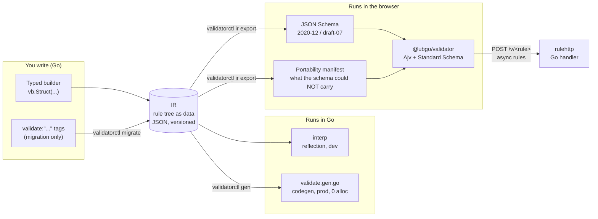
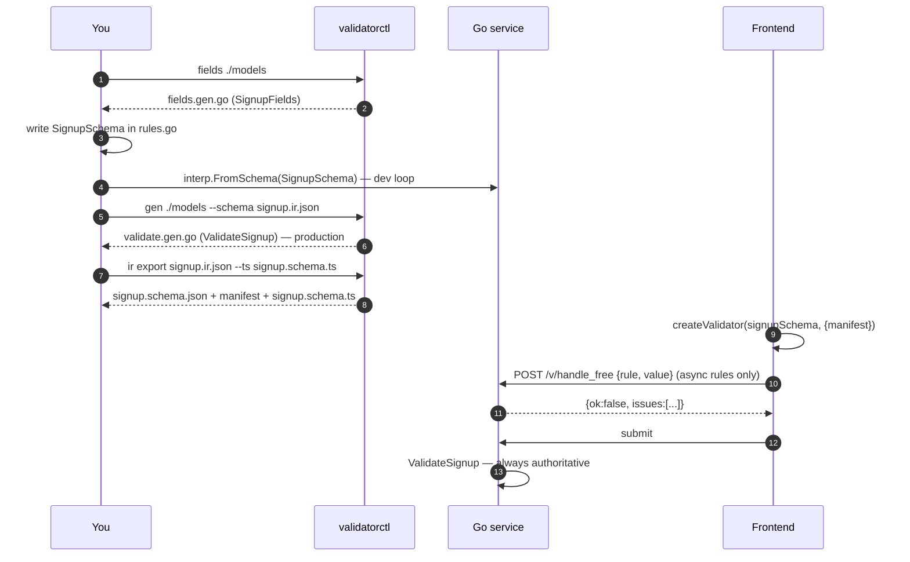
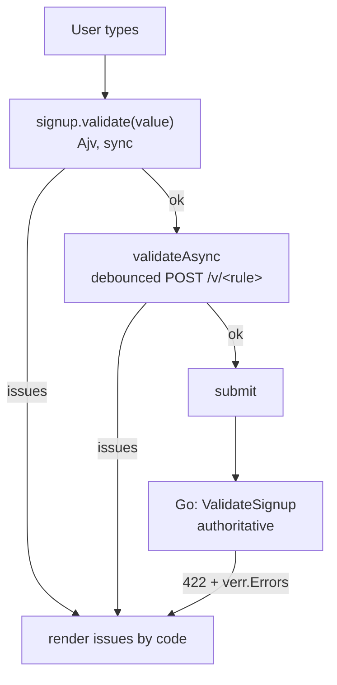

# ubgo/validator — the user guide

Everything in this guide is executed by `examples/guide_test.go`. If a snippet here does not match that file, the file is right and this guide is stale.

## Contents

1. [What it is, in one picture](#1-what-it-is-in-one-picture)
2. [Quickstart in five steps](#2-quickstart-in-five-steps)
3. [The workflow, end to end](#3-the-workflow-end-to-end)
4. [Authoring rules: every feature](#4-authoring-rules-every-feature)
5. [Exporting: JSON Schema, manifest, TypeScript](#5-exporting-json-schema-manifest-typescript)
6. [The frontend runtime](#6-the-frontend-runtime)
7. [Production: the generated executor](#7-production-the-generated-executor)
8. [Migrating from go-playground/validator](#8-migrating-from-go-playgroundvalidator)
9. [CLI reference](#9-cli-reference)
10. [What cannot cross the language boundary, and what happens instead](#10-what-cannot-cross-the-language-boundary-and-what-happens-instead)
11. [FAQ](#11-faq)

## 1. What it is, in one picture

You write validation rules once, in Go, against your own structs. Those rules are stored as data (a rule tree called the IR), not as closures. Because they are data, the same rules run in three places: a reflection interpreter for development, generated Go code for production, and an Ajv-backed TypeScript validator in the browser. Anything that cannot run in the browser is listed in a manifest instead of being silently dropped.



The rule that governs everything: **rules are data, never closures**. The only opaque things you can register are `.Custom(fn)` (Go only) and `.Async(name, endpoint, fn)` (Go runs it, the browser calls it over HTTP), and both are marked non-portable in the IR so nothing about them is hidden.

## 2. Quickstart in five steps

### Step 1: install

```sh
go get github.com/ubgo/validator
go install github.com/ubgo/validator/cli/cmd/validatorctl@latest
```

### Step 2: have a struct

Ordinary Go, ordinary `json` tags. Nothing validator-specific goes on the struct.

```go
type Signup struct {
	Email    string    `json:"email"`
	Password string    `json:"password"`
	Age      int       `json:"age"`
	Plan     string    `json:"plan"`
	Website  *string   `json:"website"`
	Tags     []string  `json:"tags"`
	Starts   time.Time `json:"starts"`
	Ends     time.Time `json:"ends"`
	Company  string    `json:"company"`
	VATID    string    `json:"vat_id"`
}
```

### Step 3: generate the field accessors

```sh
validatorctl fields ./models      # writes models/fields.gen.go
```

Or add `//go:generate validatorctl fields` to the package and run `go generate`. The output is one `SignupFields` value with a typed reference per exported field:

```go
// Code generated by validatorctl fields; DO NOT EDIT.
var SignupFields = struct {
	Email    vb.FieldRef[Signup, string]
	Password vb.FieldRef[Signup, string]
	Age      vb.FieldRef[Signup, int]
	// ...
}{
	Email:    vb.NewField("Email", func(v Signup) string { return v.Email }).JSON("email"),
	Password: vb.NewField("Password", func(v Signup) string { return v.Password }).JSON("password"),
	Age:      vb.NewField("Age", func(v Signup) int { return v.Age }).JSON("age"),
	// ...
}
```

Why accessors instead of strings: `vb.F(SignupFields.Age, vb.String())` does not compile, because `Age` is an `int`. Rename a field and every rule that mentions it breaks at compile time. Re-running the generator never touches your rules, because rules live in your own file.

### Step 4: write the rules

In your own file, next to the model:

```go
var SignupSchema = vb.Struct("Signup",
	vb.F(SignupFields.Email, vb.String().Email()).Trim().Lower(),
	vb.F(SignupFields.Password, vb.String().MinLength(8).MaxLength(72)),
	vb.F(SignupFields.Age, vb.Int[int]().Min(18).Max(120)),
	vb.F(SignupFields.Plan, vb.String().Enum("free", "pro", "team")),
	vb.F(SignupFields.Website, vb.Ptr(vb.String().URL())).Optional(),
	vb.F(SignupFields.Tags, vb.Array(vb.String().MinLength(1)).MaxItems(5).Unique()).Optional(),
	vb.F(SignupFields.Starts, vb.Time()),
	vb.F(SignupFields.Ends, vb.Time().With(vb.After(SignupFields.Starts))),
	vb.F(SignupFields.Company, vb.String()).Optional(),
	vb.F(SignupFields.VATID, vb.String().Pattern(`^[A-Z]{2}[0-9A-Z]{8,12}$`)).Optional(),
).Gate(
	// A team plan needs a company name.
	vb.Requires(vb.Eq(SignupFields.Plan, "team"), SignupFields.Company),
	// If a VAT id is given, the company must be given too.
	vb.Requires(vb.Has(SignupFields.VATID), SignupFields.Company),
).MustBuild()
```

`MustBuild` checks the whole tree at startup: unknown rule kinds, invalid regexes, regex syntax that would not run in a browser, two different functions registered under one name. A broken schema fails at boot, not on the first request.

### Step 5: validate

```go
v, err := interp.FromSchema(SignupSchema)   // once, at startup
if err != nil { log.Fatal(err) }

err = v.Validate(ctx, &in)                   // per request
var errs *verr.Errors
if errors.As(err, &errs) {
	// errs.Issues: [{code:"min_length", path:"$.password", message:"must be at least 8 characters", rule:"min_length", params:{value:8}}, ...]
	w.WriteHeader(422)
	json.NewEncoder(w).Encode(errs)
	return
}
```

For the input `{email:"  Ada@Example.com ", password:"short", age:17, plan:"team", starts:Jan 2, ends:Jan 1}` you get four issues:

| Path | Code | Why |
|---|---|---|
| `$.password` | `min_length` | 5 characters, needs 8 |
| `$.age` | `min` | 17, needs 18 |
| `$.ends` | `after` | ends before starts |
| `$.company` | `required` | plan is team, so the gate requires it |

And `in.Email` is now `ada@example.com`: transforms write back into your struct, so what you validated is what you store.

That is the whole development loop. Everything below is either more rules or more targets for the same rules.

## 3. The workflow, end to end



Where each artifact comes from:

| Artifact | Command | Commit it? |
|---|---|---|
| `fields.gen.go` | `validatorctl fields` | yes, regenerate on struct change |
| `signup.ir.json` | `json.Marshal(SignupSchema.IR())`, or a tiny `main` that writes it | yes, it is the contract |
| `validate.gen.go` | `validatorctl gen ./models --schema signup.ir.json` | yes, compiled by your build |
| `signup.schema.json` + manifest | `validatorctl ir export signup.ir.json --out ...` | yes, consumed by the frontend |
| `signup.schema.ts` | `validatorctl ir export ... --ts signup.schema.ts` | yes, imported by the frontend |

A `Taskfile.yml` or `go generate` chain that runs these in order is the usual setup; the CI job then fails when a committed artifact is stale.

## 4. Authoring rules: every feature

### 4.1 Types and their rules

Every field gets a builder matching its Go type. The builder decides which rule methods exist.

| Go type | Builder | Rules available |
|---|---|---|
| `string` | `vb.String()` | `MinLength` `MaxLength` `Pattern` `Enum` `Const` `NotBlank` and formats: `Email` `URL` `UUID` `ULID` `IP` `IPv4` `IPv6` `CIDR` `MAC` `Hostname` `Base64` `JSON` `Semver` `Date` `DateTime` `CreditCard` `JWT` `CountryCode` `CurrencyCode` `HexColor` `E164` |
| `int`, `int8`…`uint64` | `vb.Int[int]()` etc. | `Min` `Max` `Gt` `Gte` `Lt` `Lte` `MultipleOf` `Enum` `Const` |
| `float32/64` | `vb.Float[float64]()` | same as int, plus `Latitude` `Longitude` |
| `bool` | `vb.Bool()` | `Const` |
| `[]byte` | `vb.Bytes()` | `MinLength` `MaxLength` (bytes) |
| `time.Time` | `vb.Time()` | `With(vb.After(otherField))`, `With(vb.Before(otherField))` |
| `time.Duration` | `vb.Duration()` | `Min` `Max` `Gt` `Lt` |
| `[]E` | `vb.Array(elem)` | `MinItems` `MaxItems` `Unique` |
| `map[K]V` | `vb.Map(key, val)` | `MinItems` `MaxItems` |
| nested struct | `vb.Object(fields...)` inline, or `vb.Ref(OtherSchema)` | the nested schema's rules |
| `*T` | `vb.Ptr(inner)` | the inner builder's rules; nil is "absent" |
| `any` | `vb.Any[any]()`, `vb.Union[any](...)`, `vb.OneOf[any](...)` | see 4.5 |

Every builder also has `.Nullable()` (JSON `null` is acceptable), `.Describe("...")` (goes to the JSON Schema `description`) and `.Msg(code, message)` (see 4.10). Rule methods chain and each call returns a copy, so a shared builder is never mutated by a later use.

### 4.2 Fields: required, optional, transforms

`vb.F(ref, builder)` returns a field. By default a field is **required**: it must be present and non-zero (non-empty string, non-nil pointer or slice, non-zero time). Numbers and booleans are always present, because Go cannot tell `0` from "missing".

```go
vb.F(SignupFields.Website, vb.Ptr(vb.String().URL())).Optional()   // nil is fine; a value must be a URL
vb.F(SignupFields.Email, vb.String().Email()).Trim().Lower()          // transforms run before rules and write back
vb.F(SignupFields.Nick, vb.String().MinLength(2)).Default("anon")     // used when the field is absent
vb.F(SignupFields.Contact, vb.String().Email()).NormalizeEmail()      // trim + lowercase, for emails
```

Transforms in order of application: `Default` (fills an absent value) then `Trim`, `Lower`, `Upper`, `NormalizeEmail` (rewrite strings in place). `Coerce` and `NoCoerce` are about map input, see 4.6.

### 4.3 Nested structs, references, collections

```go
var AddressSchema = vb.Struct("Address",
	vb.F(AddressFields.Street, vb.String().MinLength(1)),
	vb.F(AddressFields.Zip, vb.String().Pattern(`^[0-9]{5}$`)).Optional(),
).MustBuild()

var OrderSchema = vb.Struct("Order",
	vb.F(OrderFields.Billing, vb.Ref(AddressSchema)),                    // by value
	vb.F(OrderFields.Shipping, vb.Ptr(vb.Ref(AddressSchema))).Optional(), // by pointer
	vb.F(OrderFields.Lines, vb.Array(vb.Object(                           // inline object, no separate schema
		vb.F(LineFields.Sku, vb.String().UUID()),
		vb.F(LineFields.Qty, vb.Int[int]().Gt(0)),
	)).MinItems(1)),
	vb.F(OrderFields.Meta, vb.Map(vb.String().MaxLength(3), vb.String().MinLength(1)).MaxItems(2)).Optional(),
).MustBuild()
```

A schema referenced with `vb.Ref` lands in the IR's `defs` once and is emitted as a JSON Schema `$ref`, so the frontend sees one `Address` definition. Issues inside collections carry the index or key in the path: `$.lines[2].qty`, `$.meta.abc`.

### 4.4 Cross-field rules and gates

Conditions are data too, so they survive export. The sugar:

| Sugar | Meaning |
|---|---|
| `vb.Requires(cond, fields...)` | when `cond` holds, these fields are required |
| `vb.When(cond, thenRules, elseRules)` | apply rules to fields in one branch or the other |
| `vb.Group(ir.ExactlyOne \| ir.AtLeastOne \| ir.AllOrNone, fields...)` | presence relation among fields |
| `vb.Time().With(vb.After(other))` / `vb.Before(other)` | time ordering between two fields |

Conditions: `vb.Eq(ref, v)`, `vb.Cmp(ref, ir.OpGt, v)`, `vb.In(ref, a, b)`, `vb.Has(ref)`, `vb.Missing(ref)`, `vb.FieldCmp(a, ir.OpLt, b)`, combined with `ir.And`, `ir.Or`, `ir.Not`. A rule inside a branch is written `vb.On(ref, ir.MinLength(1))`, using the `ir` constructors.

```go
.Gate(
	vb.Requires(vb.Eq(SignupFields.Plan, "team"), SignupFields.Company),
	vb.When(vb.Eq(OrderFields.Type, "online"),
		[]ir.TargetRule{vb.On(OrderFields.URL, ir.MinLength(1))},
		[]ir.TargetRule{vb.On(OrderFields.Venue, ir.MinLength(1))}),
	vb.Group(ir.AtLeastOne, OrderFields.URL, OrderFields.Venue),
)
```

In JSON Schema these become `if`/`then`/`else` blocks, which Ajv runs natively. Arithmetic between fields (`end - start < 30 days`) is the one thing conditions cannot express yet; that is the planned CEL layer.

### 4.5 Variants: discriminated unions and unions

One struct, several shapes, chosen by a field:

```go
var PaymentSchema = vb.Struct("Payment",
	vb.F(pMethod, vb.String().Enum("card", "bank")),
	vb.F(pCard, vb.String()).Optional(),
	vb.F(pIBAN, vb.String()).Optional(),
).Gate(
	vb.When(vb.Eq(pMethod, "card"),
		[]ir.TargetRule{vb.On(pCard, ir.CreditCard())},
		[]ir.TargetRule{vb.On(pIBAN, ir.MinLength(15))}),
).MustBuild()
```

When the variants are whole objects, use `vb.OneOf[T]("kind").Case("online", vb.Object(...)).Case("offline", vb.Object(...))`. The emitter turns this into a discriminator-keyed `if`/`then`/`else` chain, never a raw `oneOf`, so error messages point at the variant that was selected instead of listing every variant's failures.

An untagged union on an `any` field tries variants in order and the first pass wins:

```go
vb.F(idField, vb.Union[any](vb.Int[int]().Min(1), vb.String().UUID()))
```

### 4.6 Map input, coercion modes, time strings

The interpreter accepts `map[string]any` (a decoded JSON body, form values) as well as a struct. On map input a string where a number is expected is a type mismatch unless coercion applies:

```go
interp.FromSchema(S)                  // default: convert only fields marked .Coerce()
interp.FromSchema(S, interp.Lax())    // convert every int/float/bool/time/duration field, except .NoCoerce() ones
interp.FromSchema(S, interp.Strict()) // names the intent explicitly; same as the default
```

Field markers beat the call option in both directions. Converted values are written back into the map, so `form["age"]` becomes a number and `form["ends"]` becomes a `time.Time` (RFC 3339 strings are always accepted for time fields on map input). Struct input is never coerced: a typed field already has its type.

### 4.7 Presence rules, in one table

| Value | Present? |
|---|---|
| non-empty string | yes |
| `""` | no |
| nil pointer / slice / map | no |
| zero `time.Time` | no |
| any number, any bool | yes |
| JSON `null` on a `.Nullable()` field | acceptable, rules skipped |

A type-mismatched value gets one `type` issue and nothing else on that field.

### 4.8 Fail-fast and caller-owned results

```go
first := &verr.Errors{FailFast: true}
v.RunInto(ctx, &in, first)      // stops at the first issue
all := v.Run(ctx, &in)          // *verr.Errors, accumulates; nil-safe: all.Len()
err := v.Validate(ctx, &in)     // error interface; nil when valid
```

Fail-fast is a property of the result you own, so several schemas can report into one list and the first issue is the same one an accumulating run would have reported first.

### 4.9 Custom and async rules

```go
vb.F(handleField, vb.String().MinLength(3).
	Custom("not_reserved", func(_ context.Context, h string) error {
		if reserved[h] { return errors.New("reserved name") }
		return nil
	}).
	Async("handle_free", "/v/handle_free", func(ctx context.Context, h string) error {
		// hit the database
		return nil
	}))
```

The function is typed on the field's type. It is registered by name; the IR stores only the name and the portability class:

| Rule | Runs in Go | In the browser | Manifest class |
|---|---|---|---|
| `Custom` | yes | no; warned once, enforced on submit | `opaque` |
| `Async` | yes | `validateAsync` POSTs `{rule, value}` to the endpoint, debounced | `server` |

Serving async rules is one line: `rulehttp.FromSchema(ProfileSchema)` returns an `http.Handler` that answers `POST /v/handle_free` with `{ok:true}` or `{ok:false, issues:[...]}`. It has a 64 KiB body cap, a per-IP token bucket and an `WithAuthorize` hook; custom rules are never served. The backend stays authoritative: the round-trip is UX, `Validate` on submit is the decision.

### 4.10 Messages, codes and translations

Every issue carries a machine `code`, a `path`, the `rule` kind, `params`, and a rendered `message`. Override code and message per rule:

```go
vb.String().MinLength(8).Msg("weak_password", "use at least {value} characters")
```

Translations are a JSON catalog keyed by code. `validatorctl catalog` prints the built-in English one; a partial translation is merged over it; `validatorctl catalog --check de.json` fails CI when a code is missing.

```go
de, _ := i18n.Load(file)
cat := i18n.Merge(i18n.Default(), de)
localized := cat.Localize(v.Run(ctx, &in))   // same issues, German messages
```

The same catalog file is the TypeScript runtime's `catalog` option, so both sides render one wording.

## 5. Exporting: JSON Schema, manifest, TypeScript

```go
res, _ := jsonschema.Emit(SignupSchema.IR(), jsonschema.WithID("https://example.com/signup.json"))
doc, _ := res.JSON()                  // draft 2020-12 by default; jsonschema.WithDraft(jsonschema.Draft07) for classic Ajv / OpenAPI 3.0
for _, e := range res.Manifest.Entries { fmt.Println(e.Path, e.Kind, e.Name, e.Class, e.Reason) }
ts, _ := res.TSModule("signup")       // `export const signupSchema = {...} as const; export const signupManifest = ...`
```

From the CLI, all three at once:

```sh
validatorctl ir export signup.ir.json --out web/src/signup.schema.json --ts web/src/signup.schema.ts
```

For the quickstart schema the manifest lists three entries: the `after` rule on `$.ends` (cross-field, JSON Schema cannot express it) and the `trim` and `lower` transforms on `$.email` (JSON Schema validates, it does not transform). The browser validator warns once about each and the server enforces them. Nothing is dropped without a line in that list.

Output is byte-deterministic, so generated files diff cleanly.

The IR document itself has a schema: `validatorctl ir contract` prints it, and `validatorctl ir check signup.ir.json` validates a document structurally.

## 6. The frontend runtime

```sh
pnpm add @ubgo/validator
```

```ts
import { createValidator } from "@ubgo/validator";
import { signupSchema, signupManifest } from "./signup.schema";   // the --ts export

const signup = createValidator(signupSchema, {
  manifest: signupManifest,
  baseURL: "https://api.example.com",       // for async rules
  catalog: deCatalog,                        // optional, same JSON as the Go side
});

const r = signup.validate(input);            // sync: { ok: true, value } | { ok: false, issues }
const full = await signup.validateAsync(input); // also round-trips async rules, debounced
```

The value type is inferred from the const schema, so `r.value` is typed without writing a TypeScript interface. The validator implements Standard Schema and Standard JSON Schema, which means it drops into consumers without adapters:

```ts
app.post("/users", sValidator("json", signup), (c) => c.json(c.req.valid("json")));   // Hono
const form = useForm({ validators: { onChange: signup } });                            // TanStack Form
t.procedure.input(signup)                                                              // tRPC v11
```

Issues have the same `code`, `path`, `rule` and `params` as Go, so one error-rendering component serves both the optimistic browser result and the authoritative server response.



## 7. Production: the generated executor

The interpreter is fine for most services. When a validator is on a hot path, generate it:

```sh
validatorctl gen ./models --schema signup.ir.json     # writes models/validate.gen.go
```

```go
errs := models.ValidateSignup(ctx, &in, SignupSchema)   // *verr.Errors, nil when valid
first := &verr.Errors{FailFast: true}
models.ValidateSignupInto(ctx, &in, SignupSchema, first)
```

The third argument is the registry that resolves custom and async rules by name; your `vb.Schema` is one. Generated code and the interpreter are conformance-tested to produce identical issues, so you can switch between them without behavior change.

| Path | ns/op | allocs/op |
|---|---|---|
| generated, `Into` | 490 | 0 |
| generated | 510 | 1 |
| interpreter | 9700 | 81 |

Measured on the repository's example fixture (a union, a discriminated union, transforms, two custom rules, a gate predicate), arm64.

## 8. Migrating from go-playground/validator

```sh
validatorctl fields ./models
validatorctl migrate ./models --type Signup --out signup.ir.json --builder schema.gen.go
```

The migration reads `validate:"..."` tags on the root struct and every struct it references, writes the IR, and writes `vb` builder source using the generated accessors so you can start editing rules as code. Every tag it cannot express is reported with a reason and an alternative, and the command exits 1 unless you pass `--allow-partial`, so a lossy migration is a decision you made, not something that happened.

Honesty rules the migration follows: a field without `required` becomes `Optional`; `min`/`max`/`len` on strings and collections are lengths, on numbers bounds; `gt`/`lt` on lengths become inclusive by one; `oneof` becomes `Enum`; `eqfield` and friends on time fields become `After`/`Before`, on anything else they are reported (they need the CEL layer).

## 9. CLI reference

Every command supports `--json` for a machine-readable envelope and exits non-zero on failure.

| Command | What it does |
|---|---|
| `validatorctl fields [dir]` | generate `<Type>Fields` accessors into `fields.gen.go` (`--type`, `--unexported`, `--dry-run`) |
| `validatorctl gen [dir] --schema f.json` | generate `Validate<Type>` functions into `validate.gen.go` |
| `validatorctl migrate [dir] --type T` | tags → IR (`--out`) and builder source (`--builder`); `--allow-partial` |
| `validatorctl ir check f.json` | structural check of an IR document |
| `validatorctl ir export f.json` | JSON Schema (`--draft 2020\|07`, `--id`, `--out`), manifest (`--manifest`), TS module (`--ts`, `--name`) |
| `validatorctl ir contract` | the JSON Schema of the IR format itself |
| `validatorctl catalog` | print the default message catalog; `--check de.json` lists missing codes |
| `validatorctl version` | build info |

## 10. What cannot cross the language boundary, and what happens instead

| Feature | Go | Browser | Reported as |
|---|---|---|---|
| Formats, lengths, bounds, enums, patterns, nesting, arrays, maps, conditions, gates, discriminated unions | runs | runs (JSON Schema) | nothing to report |
| `.Custom(fn)` | runs | warns once, server enforces | manifest `opaque` |
| `.Async(name, endpoint, fn)` | runs | debounced round-trip | manifest `server` |
| `After` / `Before` between fields | runs | server enforces | manifest `cel` (the class reserved for the planned expression layer) |
| `Trim` / `Lower` / `Upper` / `NormalizeEmail` | runs, writes back | not applied | manifest `lossy` |
| `.Coerce()` | runs on map input | Ajv `coerceTypes` for the whole schema | manifest `lossy` |
| `.NoCoerce()` | pins the field | cannot exempt one property | manifest `lossy` |
| `MaxLength` on `[]byte` | bytes | characters of the base64 string | manifest `lossy` |
| Regex with lookahead, named groups, inline flags | refused at `MustBuild` | n/a | build error |

The design promise is that this table is exhaustive by construction: the emitter has no code path that drops a rule without adding a manifest entry.

## 11. FAQ

**Do I have to run codegen?** No. The interpreter runs the same rules with identical results; codegen is an optimization for hot paths.

**Can I write the IR JSON by hand or from another language?** Yes. `validatorctl ir contract` gives you the schema, `validatorctl ir check` validates a document, and `interp.New(&schema, interp.WithFuncs(registry))` runs it. Names of custom rules must then be resolved by a registry you supply.

**Why not just export Zod?** Zod is on the roadmap as an eject target. JSON Schema was chosen first because it is what OpenAPI, Ajv, and most other languages already consume, and Standard Schema makes the Ajv-backed validator usable wherever Zod would be.

**What about struct tags?** They are a migration input only. Tags are opaque strings that cannot be type-checked or exported faithfully, which is the problem this library exists to remove.

**Where do I put the schema file?** Next to the model, generated from a tiny `main` or a test that marshals `SignupSchema.IR()` and fails when the committed file differs. The repository's own goldens work that way.
