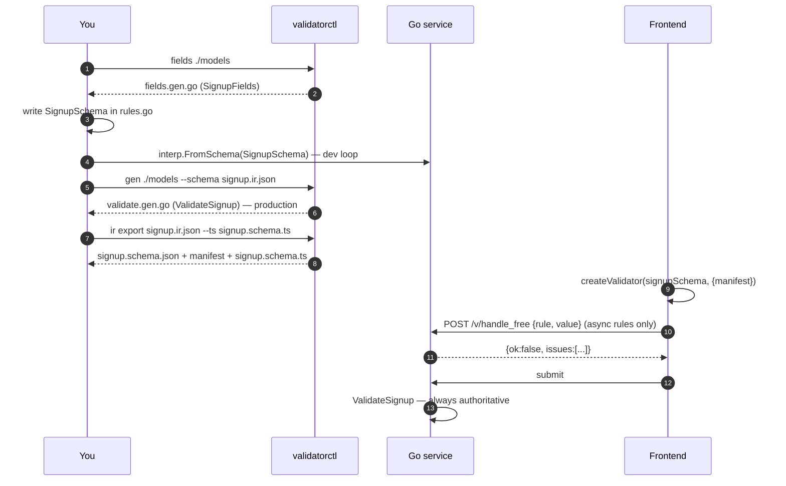
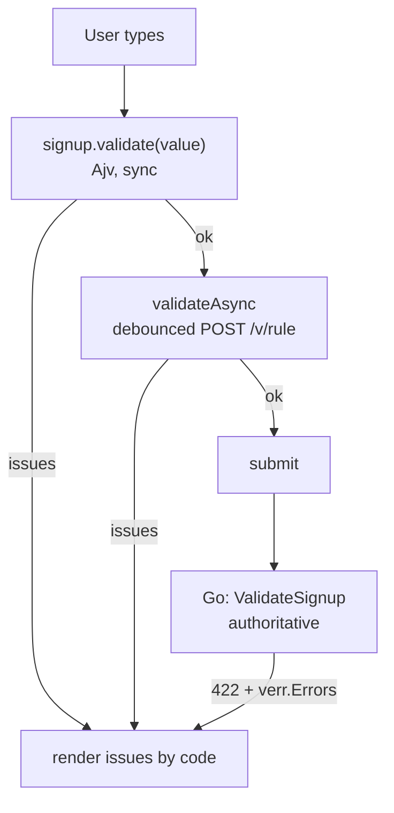

# ubgo/validator — the user guide

The files this guide shows live in `examples/guide/` and are compiled by the build; `examples/guide_test.go` asserts the behaviors claimed for them and that the guide embeds those files verbatim. If this guide and the repository disagree, the repository is right and this guide is stale.

## Contents

1. [What it is, in one picture](#1-what-it-is-in-one-picture)
2. [Quickstart in five steps](#2-quickstart-in-five-steps)
3. [The workflow, end to end](#3-the-workflow-end-to-end)
4. [Authoring rules: every feature](#4-authoring-rules-every-feature) (types, fields, nesting, gates, variants, map input, presence, results, custom and async, messages, unknown keys, foreign IR)
5. [Exporting: JSON Schema, manifest, TypeScript](#5-exporting-json-schema-manifest-typescript)
6. [The frontend runtime](#6-the-frontend-runtime)
7. [Production: the generated executor](#7-production-the-generated-executor)
8. [Migrating from go-playground/validator](#8-migrating-from-go-playgroundvalidator)
9. [CLI reference](#9-cli-reference)
10. [What cannot cross the language boundary, and what happens instead](#10-what-cannot-cross-the-language-boundary-and-what-happens-instead)
11. [FAQ](#11-faq)

## 1. What it is, in one picture

You write validation rules once, in Go, against your own structs. Those rules are stored as data (a rule tree called the IR), not as closures. Because they are data, the same rules run in three places: a reflection interpreter for development, generated Go code for production, and an Ajv-backed TypeScript validator in the browser. Anything that cannot run in the browser is listed in a manifest instead of being silently dropped.


The rule that governs everything: **rules are data, never closures**. The only opaque things you can register are `.Custom(fn)` (Go only) and `.Async(name, endpoint, fn)` (Go runs it, the browser calls it over HTTP), and both are marked non-portable in the IR so nothing about them is hidden.

## 2. Quickstart in five steps

Every file below is in the repository at `examples/guide/`, compiled by the build, and shown here verbatim; a test fails when this guide and those files differ. Paths in the commands are relative to `examples/`.

### Step 1: install

```sh
go get github.com/ubgo/validator
go install github.com/ubgo/validator/cli/cmd/validatorctl@latest
```

### Step 2: have a struct

File `guide/signup/model.go`. Ordinary Go, ordinary `json` tags. Nothing validator-specific goes on the struct.

```go
// Package signup is the user guide's running example: an ordinary struct,
// its generated field accessors, and the rules written against them. Every
// file here is compiled by the build and shown verbatim in docs/GUIDE.md.
package signup

import "time"

// Regenerate everything derived from this package, in order: the field
// accessors, the IR document, then the reflection-free validator.
//
//go:generate validatorctl fields
//go:generate go run ../cmd/signup-export -dir .
//go:generate validatorctl gen . --schema signup.ir.json

// Signup is the request body of POST /signup. Nothing validator-specific
// lives on the struct; rules are in rules.go.
type Signup struct {
	Email    string    `json:"email"`
	Password string    `json:"password"`
	Age      int       `json:"age"`
	Plan     string    `json:"plan"`
	Website  *string   `json:"website"`
	Tags     []string  `json:"tags"`
	Starts   time.Time `json:"starts"`
	Ends     time.Time `json:"ends"`
	Company  string    `json:"company"`
	VATID    string    `json:"vat_id"`
}
```

### Step 3: generate the field accessors

```sh
cd guide/signup && validatorctl fields      # or: go generate ./...
```

The generator writes `guide/signup/fields.gen.go`, one `SignupFields` value with a typed reference per exported field:

```go
// Code generated by validatorctl fields; DO NOT EDIT.

package signup

import (
	"github.com/ubgo/validator/vb"
	"time"
)

// SignupFields names every field of Signup for rule authoring.
// Use with vb.F: vb.F(SignupFields.<Field>, vb.<Builder>()).
var SignupFields = struct {
	Email    vb.FieldRef[Signup, string]
	Password vb.FieldRef[Signup, string]
	Age      vb.FieldRef[Signup, int]
	Plan     vb.FieldRef[Signup, string]
	Website  vb.FieldRef[Signup, *string]
	Tags     vb.FieldRef[Signup, []string]
	Starts   vb.FieldRef[Signup, time.Time]
	Ends     vb.FieldRef[Signup, time.Time]
	Company  vb.FieldRef[Signup, string]
	VATID    vb.FieldRef[Signup, string]
}{
	Email:    vb.NewField("Email", func(v Signup) string { return v.Email }).JSON("email"),
	Password: vb.NewField("Password", func(v Signup) string { return v.Password }).JSON("password"),
	Age:      vb.NewField("Age", func(v Signup) int { return v.Age }).JSON("age"),
	Plan:     vb.NewField("Plan", func(v Signup) string { return v.Plan }).JSON("plan"),
	Website:  vb.NewField("Website", func(v Signup) *string { return v.Website }).JSON("website"),
	Tags:     vb.NewField("Tags", func(v Signup) []string { return v.Tags }).JSON("tags"),
	Starts:   vb.NewField("Starts", func(v Signup) time.Time { return v.Starts }).JSON("starts"),
	Ends:     vb.NewField("Ends", func(v Signup) time.Time { return v.Ends }).JSON("ends"),
	Company:  vb.NewField("Company", func(v Signup) string { return v.Company }).JSON("company"),
	VATID:    vb.NewField("VATID", func(v Signup) string { return v.VATID }).JSON("vat_id"),
}
```

Why accessors instead of strings: `vb.F(SignupFields.Age, vb.String())` does not compile, because `Age` is an `int`. Rename a field and every rule that mentions it breaks at compile time. Re-running the generator never touches your rules, because rules live in your own file.

### Step 4: write the rules

File `guide/signup/rules.go`, in the same package as the model:

```go
package signup

import (
	"context"
	"errors"

	"github.com/ubgo/validator/vb"
)

// reserved is what the not_reserved custom rule consults. In a real
// service this is a table; here it is enough to show the rule shape.
var reserved = map[string]bool{"admin@example.com": true, "root@example.com": true}

// Schema holds every rule for Signup. It is built once at package init and
// checked then: an invalid regex, an unknown rule or two functions
// registered under one name panic at startup, never on a request.
var Schema = vb.Struct("Signup",
	vb.F(SignupFields.Email, vb.String().Email().
		// Go-only rule: runs on the server, the browser is told it exists.
		Custom("not_reserved", func(_ context.Context, email string) error {
			if reserved[email] {
				return errors.New("reserved address")
			}
			return nil
		}).
		// Server-backed rule: Go runs it; the browser POSTs to /v/email_free.
		Async("email_free", "/v/email_free", func(_ context.Context, email string) error {
			if email == "taken@example.com" {
				return errors.New("already registered")
			}
			return nil
		})).Trim().Lower(),
	vb.F(SignupFields.Password, vb.String().MinLength(8).MaxLength(72)),
	vb.F(SignupFields.Age, vb.Int[int]().Min(18).Max(120)),
	vb.F(SignupFields.Plan, vb.String().Enum("free", "pro", "team")),
	vb.F(SignupFields.Website, vb.Ptr(vb.String().URL())).Optional(),
	vb.F(SignupFields.Tags, vb.Array(vb.String().MinLength(1)).MaxItems(5).Unique()).Optional(),
	vb.F(SignupFields.Starts, vb.Time()),
	vb.F(SignupFields.Ends, vb.Time().With(vb.After(SignupFields.Starts))),
	vb.F(SignupFields.Company, vb.String()).Optional(),
	vb.F(SignupFields.VATID, vb.String().Pattern(`^[A-Z]{2}[0-9A-Z]{8,12}$`)).Optional(),
).Gate(
	// A team plan needs a company name.
	vb.Requires(vb.Eq(SignupFields.Plan, "team"), SignupFields.Company),
	// If a VAT id is given, the company must be given too.
	vb.Requires(vb.Has(SignupFields.VATID), SignupFields.Company),
).MustBuild()
```

`MustBuild` checks the whole tree at startup: unknown rule kinds, invalid regexes, regex syntax that would not run in a browser, two different functions registered under one name. A broken schema fails at boot, not on the first request. `Build()` is the same check returning an `error` that lists every problem at once, for tools that load schemas dynamically. `.Source("models/rules.go")` and `.Generator("myproject")` before `Build` record provenance in the IR's metadata.

### Step 5: validate in an HTTP handler

File `guide/cmd/signup-server/main.go`, a complete program:

```go
// Command signup-server is the guide's complete HTTP example: decode a JSON
// body into the struct, validate it, answer 422 with the issues, and serve
// the async rules the browser round-trips to.
//
//	go run ./guide/cmd/signup-server -addr :8080
//	curl -s -X POST localhost:8080/signup -d '{"email":" Ada@Example.com ","password":"short","age":17,"plan":"team","starts":"2026-01-02T00:00:00Z","ends":"2026-01-01T00:00:00Z"}'
//	curl -s -X POST localhost:8080/v/email_free -d '{"rule":"email_free","value":"taken@example.com"}'
package main

import (
	"encoding/json"
	"errors"
	"flag"
	"log"
	"net/http"

	"github.com/ubgo/validator/examples/guide/signup"
	"github.com/ubgo/validator/interp"
	"github.com/ubgo/validator/rulehttp"
	"github.com/ubgo/validator/verr"
)

// maxBody bounds the request body so a client cannot make the decoder
// allocate without limit.
const maxBody = 1 << 20

func main() {
	addr := flag.String("addr", ":8080", "listen address")
	flag.Parse()

	// Compile the schema once. FromSchema checks the IR, compiles every
	// regex and resolves every custom/async name against the schema's
	// registry; anything it cannot execute is an error here, not later.
	validate, err := interp.FromSchema(signup.Schema)
	if err != nil {
		log.Fatal(err)
	}

	// The async rules, served at their declared endpoints (POST /v/email_free).
	rules, err := rulehttp.FromSchema(signup.Schema)
	if err != nil {
		log.Fatal(err)
	}

	mux := http.NewServeMux()
	mux.Handle("/v/", rules)
	mux.HandleFunc("POST /signup", func(w http.ResponseWriter, r *http.Request) {
		var in signup.Signup
		if err := json.NewDecoder(http.MaxBytesReader(w, r.Body, maxBody)).Decode(&in); err != nil {
			http.Error(w, "malformed JSON: "+err.Error(), http.StatusBadRequest)
			return
		}

		// Validate the decoded struct. Transforms (Trim, Lower on email)
		// write back into `in`, so what was validated is what gets stored.
		err := validate.Validate(r.Context(), &in)
		var errs *verr.Errors
		if errors.As(err, &errs) {
			w.Header().Set("Content-Type", "application/json")
			w.WriteHeader(http.StatusUnprocessableEntity)
			// Body: {"issues":[{"code":"min_length","path":"$.password","message":"must be at least 8 characters","rule":"min_length","params":{"value":8}}, ...]}
			_ = json.NewEncoder(w).Encode(errs)
			return
		}

		// Valid: in.Email is now trimmed and lowercased.
		w.Header().Set("Content-Type", "application/json")
		_ = json.NewEncoder(w).Encode(map[string]string{"status": "created", "email": in.Email})
	})

	log.Println("listening on", *addr)
	log.Fatal(http.ListenAndServe(*addr, mux))
}
```

Run it and send a bad body:

```sh
go run ./guide/cmd/signup-server -addr :8080
curl -s -X POST localhost:8080/signup -d '{"email":" Ada@Example.com ","password":"short","age":17,"plan":"team","starts":"2026-01-02T00:00:00Z","ends":"2026-01-01T00:00:00Z"}'
```

The response, status 422:

```json
{"issues":[
  {"code":"min_length","path":"$.password","message":"must be at least 8 characters","rule":"minLength","params":{"value":8}},
  {"code":"min","path":"$.age","message":"must be at least 18","rule":"min","params":{"value":18}},
  {"code":"after","path":"$.ends","message":"must be after Starts","rule":"after","params":{"field":"Starts"}},
  {"code":"required","path":"$.company","message":"field is required"}
]}
```

| Field | Meaning |
|---|---|
| `code` | what programs and translators key on; defaults from the rule, overridable per rule |
| `path` | JSONPath with wire names, `$.lines[2].qty` inside collections |
| `message` | the default English rendering, replaceable by a catalog |
| `rule` | the rule kind that failed; absent for structural failures such as `required` |
| `params` | the rule's operands, for rendering your own message |

A valid body answers `{"email":"ada@example.com","status":"created"}`: the email was trimmed and lowercased in place before the rules ran, so what you validated is what you store.

That is the whole development loop. Everything below is either more rules or more targets for the same rules.

## 3. The workflow, end to end



Where each artifact comes from:

| Artifact | Command | Commit it? |
|---|---|---|
| `fields.gen.go` | `validatorctl fields` | yes, regenerate on struct change |
| `signup.ir.json` | `go run ./guide/cmd/signup-export` (it marshals `signup.Schema.IR()`) | yes, it is the contract |
| `validate.gen.go` | `validatorctl gen guide/signup --schema signup.ir.json` | yes, compiled by your build |
| `signup.schema.json` + manifest | `signup-export`, or `validatorctl ir export signup.ir.json --out ...` | yes, consumed by the frontend |
| `signup.schema.ts` | `signup-export`, or `validatorctl ir export ... --ts signup.schema.ts` | yes, imported by the frontend |

A `Taskfile.yml` or `go generate` chain that runs these in order is the usual setup; the CI job then fails when a committed artifact is stale.

## 4. Authoring rules: every feature

### 4.1 Types and their rules

Every field gets a builder matching its Go type. The builder decides which rule methods exist.

| Go type | Builder | Rules available |
|---|---|---|
| `string` | `vb.String()` | `MinLength` `MaxLength` `Pattern` `Enum` `Const` `NotBlank` and formats: `Email` `URL` `UUID` `ULID` `IP` `IPv4` `IPv6` `CIDR` `MAC` `Hostname` `Base64` `JSON` `Semver` `Date` `DateTime` `CreditCard` `JWT` `CountryCode` `CurrencyCode` `HexColor` `E164` |
| `int`, `int8`…`uint64` | `vb.Int[int]()` etc. | `Min` `Max` `Gt` `Gte` `Lt` `Lte` `MultipleOf` `Enum` `Const` |
| `float32/64` | `vb.Float[float64]()` | same as int, plus `Latitude` `Longitude` |
| `bool` | `vb.Bool()` | `Const` |
| `[]byte` | `vb.Bytes()` | `MinLength` `MaxLength` (bytes) |
| `time.Time` | `vb.Time()` | `With(vb.After(otherField))`, `With(vb.Before(otherField))`; `vb.AfterField("Starts")` / `vb.BeforeField` take the Go field name as a string, which is what the tag migration emits |
| `time.Duration` | `vb.Duration()` | `Min` `Max` `Gt` `Lt` |
| `[]E` | `vb.Array(elem)` | `MinItems` `MaxItems` `Unique` |
| `map[K]V` | `vb.Map(key, val)` | `MinItems` `MaxItems` |
| nested struct | `vb.Object(fields...)` inline, or `vb.Ref(OtherSchema)` | the nested schema's rules |
| `*T` | `vb.Ptr(inner)` | the inner builder's rules; nil is "absent" |
| `any` | `vb.Any[any]()`, `vb.Union[any](...)`, `vb.OneOf[any](...)` | see 4.5 |

Every builder also has `.Nullable()` (JSON `null` is acceptable), `.Describe("...")` (goes to the JSON Schema `description`) and `.Msg(code, message)` (see 4.10). Rule methods chain and each call returns a copy, so a shared builder is never mutated by a later use.

### 4.2 Fields: required, optional, transforms

`vb.F(ref, builder)` returns a field. By default a field is **required**: it must be present and non-zero (non-empty string, non-nil pointer or slice, non-zero time). Numbers and booleans are always present, because Go cannot tell `0` from "missing".

```go
vb.F(SignupFields.Website, vb.Ptr(vb.String().URL())).Optional()   // nil is fine; a value must be a URL
vb.F(SignupFields.Email, vb.String().Email()).Trim().Lower()          // transforms run before rules and write back
vb.F(SignupFields.Nick, vb.String().MinLength(2)).Default("anon")     // used when the field is absent
vb.F(SignupFields.Contact, vb.String().Email()).NormalizeEmail()      // trim + lowercase, for emails
```

Transforms in order of application: `Default` (fills an absent value) then `Trim`, `Lower`, `Upper`, `NormalizeEmail` (rewrite strings in place). `Coerce` and `NoCoerce` are about map input, see 4.6.

### 4.3 Nested structs, references, collections

```go
var AddressSchema = vb.Struct("Address",
	vb.F(AddressFields.Street, vb.String().MinLength(1)),
	vb.F(AddressFields.Zip, vb.String().Pattern(`^[0-9]{5}$`)).Optional(),
).MustBuild()

var OrderSchema = vb.Struct("Order",
	vb.F(OrderFields.Billing, vb.Ref(AddressSchema)),                    // by value
	vb.F(OrderFields.Shipping, vb.Ptr(vb.Ref(AddressSchema))).Optional(), // by pointer
	vb.F(OrderFields.Lines, vb.Array(vb.Object(                           // inline object, no separate schema
		vb.F(LineFields.Sku, vb.String().UUID()),
		vb.F(LineFields.Qty, vb.Int[int]().Gt(0)),
	)).MinItems(1)),
	vb.F(OrderFields.Meta, vb.Map(vb.String().MaxLength(3), vb.String().MinLength(1)).MaxItems(2)).Optional(),
).MustBuild()
```

A schema referenced with `vb.Ref` lands in the IR's `defs` once and is emitted as a JSON Schema `$ref`, so the frontend sees one `Address` definition. Issues inside collections carry the index or key in the path: `$.lines[2].qty`, `$.meta.abc`.

### 4.4 Cross-field rules and gates

Conditions are data too, so they survive export. The sugar:

| Sugar | Meaning |
|---|---|
| `vb.Requires(cond, fields...)` | when `cond` holds, these fields are required |
| `vb.When(cond, thenRules, elseRules)` | apply rules to fields in one branch or the other |
| `vb.Group(ir.ExactlyOne \| ir.AtLeastOne \| ir.AllOrNone, fields...)` | presence relation among fields |
| `vb.Time().With(vb.After(other))` / `vb.Before(other)` | time ordering between two fields |

Conditions: `vb.Eq(ref, v)`, `vb.Cmp(ref, ir.OpGt, v)`, `vb.In(ref, a, b)`, `vb.Has(ref)`, `vb.Missing(ref)`, `vb.FieldCmp(a, ir.OpLt, b)`, combined with `ir.And`, `ir.Or`, `ir.Not`. A rule inside a branch is written `vb.On(ref, ir.MinLength(1))`, using the `ir` constructors.

```go
.Gate(
	vb.Requires(vb.Eq(SignupFields.Plan, "team"), SignupFields.Company),
	vb.When(vb.Eq(OrderFields.Type, "online"),
		[]ir.TargetRule{vb.On(OrderFields.URL, ir.MinLength(1))},
		[]ir.TargetRule{vb.On(OrderFields.Venue, ir.MinLength(1))}),
	vb.Group(ir.AtLeastOne, OrderFields.URL, OrderFields.Venue),
)
```

In JSON Schema these become `if`/`then`/`else` blocks, which Ajv runs natively. Arithmetic between fields (`end - start < 30 days`) is the one thing conditions cannot express yet; that is the planned CEL layer (`ir.Expr("...")` exists in the IR and is refused by both executors until then).

A condition can also be a Go predicate, by name. The gate says `ir.CustomCond("vip")`; a registry supplies the function. The predicate is Go-only, so the manifest lists it and the browser skips the gate.

```go
package main

import (
	"context"
	"errors"
	"log"
	"strings"

	"github.com/ubgo/validator/examples/guide/signup"
	"github.com/ubgo/validator/interp"
	"github.com/ubgo/validator/ir"
	"github.com/ubgo/validator/vb"
)

// vipRegistry answers the schema's own rule names and adds the "vip"
// predicate. Anything with a Func(name) method is a registry; generated
// code accepts the same type.
type vipRegistry struct{ base *vb.Schema[signup.Signup] }

func (r vipRegistry) Func(name string) (vb.Func, bool) {
	if name == "vip" {
		return func(_ context.Context, v any) error {
			if s, ok := v.(signup.Signup); ok && strings.HasSuffix(s.Email, "@vip.example.com") {
				return nil
			}
			return errors.New("not vip")
		}, true
	}
	return r.base.Func(name)
}

func main() {
	gated := vb.Struct("Signup",
		vb.F(signup.SignupFields.Email, vb.String().Email()),
		vb.F(signup.SignupFields.Age, vb.Int[int]()),
	).Gate(
		// Non-VIPs must be 21 or older.
		vb.When(ir.CustomCond("vip"), nil, []ir.TargetRule{vb.On(signup.SignupFields.Age, ir.Min(21))}),
	).MustBuild()

	// FromSchema would fail here: the schema's own registry does not know "vip".
	v, err := interp.New(gated.IR(), interp.WithFuncs(vipRegistry{base: gated}))
	if err != nil {
		log.Fatal(err)
	}
	log.Println(v.Validate(context.Background(), &signup.Signup{Email: "a@example.com", Age: 18})) // $.age: must be at least 21
}
```

### 4.5 Variants: discriminated unions and unions

One struct, several shapes, chosen by a field:

```go
var PaymentSchema = vb.Struct("Payment",
	vb.F(pMethod, vb.String().Enum("card", "bank")),
	vb.F(pCard, vb.String()).Optional(),
	vb.F(pIBAN, vb.String()).Optional(),
).Gate(
	vb.When(vb.Eq(pMethod, "card"),
		[]ir.TargetRule{vb.On(pCard, ir.CreditCard())},
		[]ir.TargetRule{vb.On(pIBAN, ir.MinLength(15))}),
).MustBuild()
```

When the variants are whole objects, use `vb.OneOf[T]("kind").Case("online", vb.Object(...)).Case("offline", vb.Object(...))`. The emitter turns this into a discriminator-keyed `if`/`then`/`else` chain, never a raw `oneOf`, so error messages point at the variant that was selected instead of listing every variant's failures. A tag that matches no case is an `unknown_variant` issue, unless you add `.Default(vb.Object(...))`, which then validates every unlisted tag:

```go
vb.F(ev, vb.OneOf[Event]("kind").
	Case("online", vb.Object(vb.F(kind, vb.String().Const("online")), vb.F(url, vb.String().URL()))).
	Default(vb.Object(vb.F(kind, vb.String()), vb.F(url, vb.String()).Optional())))
```

An untagged union on an `any` field tries variants in order and the first pass wins:

```go
vb.F(idField, vb.Union[any](vb.Int[int]().Min(1), vb.String().UUID()))
```

### 4.6 Map input, coercion modes, time strings

The interpreter accepts `map[string]any` (a decoded JSON body, form values) as well as a struct. On map input a string where a number is expected is a type mismatch unless coercion applies. A complete example, using the guide's schema:

```go
package main

import (
	"context"
	"fmt"
	"log"
	"time"

	"github.com/ubgo/validator/examples/guide/signup"
	"github.com/ubgo/validator/interp"
)

func main() {
	// Lax: convert every int/float/bool/time/duration field from strings,
	// except fields marked .NoCoerce(). The mode for form and query input.
	lax, err := interp.FromSchema(signup.Schema, interp.Lax())
	if err != nil {
		log.Fatal(err)
	}
	form := map[string]any{
		"email": "ada@example.com", "password": "correct horse", "age": "30", "plan": "free",
		"starts": "2026-01-01T00:00:00Z", "ends": "2026-01-02T00:00:00Z",
	}
	if err := lax.Validate(context.Background(), form); err != nil {
		log.Fatal(err)
	}
	// Converted values were written back into the map.
	fmt.Printf("%T %T\n", form["age"], form["ends"]) // float64 time.Time
	_ = form["ends"].(time.Time)

	// Default mode: only fields marked .Coerce() convert; "30" is a type issue.
	strict, _ := interp.FromSchema(signup.Schema)
	fmt.Println(strict.Validate(context.Background(), map[string]any{
		"email": "ada@example.com", "password": "correct horse", "age": "30", "plan": "free",
		"starts": "2026-01-01T00:00:00Z", "ends": "2026-01-02T00:00:00Z",
	})) // $.age: expected integer, got string
}
```

| Mode | Converts |
|---|---|
| default (`CoerceMarked`) | only fields marked `.Coerce()` |
| `interp.Lax()` | every convertible field, except those marked `.NoCoerce()` |
| `interp.Strict()` | same as the default; names the intent |
| `interp.WithCoerce(mode)` | the same three as a value, for configuration-driven setups |

Field markers beat the call option in both directions. RFC 3339 strings are always accepted for time fields on map input. Struct input is never coerced: a typed field already has its type.

### 4.7 Presence rules, in one table

| Value | Present? |
|---|---|
| non-empty string | yes |
| `""` | no |
| nil pointer / slice / map | no |
| zero `time.Time` | no |
| any number, any bool | yes |
| JSON `null` on a `.Nullable()` field | acceptable, rules skipped |

A type-mismatched value gets one `type` issue and nothing else on that field.

### 4.8 Fail-fast and caller-owned results

```go
package main

import (
	"context"
	"fmt"
	"log"

	"github.com/ubgo/validator/examples/guide/signup"
	"github.com/ubgo/validator/interp"
	"github.com/ubgo/validator/verr"
)

func main() {
	v, err := interp.FromSchema(signup.Schema)
	if err != nil {
		log.Fatal(err)
	}
	empty := signup.Signup{}

	first := &verr.Errors{FailFast: true}
	v.RunInto(context.Background(), &empty, first) // stops at the first issue
	fmt.Println(first.Len())                       // 1

	all := v.Run(context.Background(), &empty) // *verr.Errors, accumulates; nil-safe Len()
	fmt.Println(all.Len())                     // 6: five required fields and age below 18

	err = v.Validate(context.Background(), &empty) // error interface, nil when valid
	fmt.Println(err != nil)                        // true
}
```

Fail-fast is a property of the result you own, so several schemas can report into one list, and the first issue is the same one an accumulating run would have reported first.

More on results, as a complete program:

```go
package main

import (
	"context"
	"fmt"
	"log"

	"github.com/ubgo/validator/examples/guide/signup"
	"github.com/ubgo/validator/interp"
	"github.com/ubgo/validator/verr"
)

func main() {
	v, err := interp.FromSchema(signup.Schema)
	if err != nil {
		log.Fatal(err)
	}

	// Validate a sub-document: paths start at the prefix you give.
	errs := &verr.Errors{}
	v.RunIntoAt(context.Background(), &signup.Signup{}, "$.body", errs)
	fmt.Println(errs.Issues[0].Path) // $.body.email

	// Group by path for per-field rendering.
	for path, issues := range errs.ByPath() {
		fmt.Println(path, len(issues), issues[0].Code)
	}

	// OrNil and Len are safe on a nil *verr.Errors, so a handler can hold one
	// variable for "no issues" and "some issues".
	var none *verr.Errors
	fmt.Println(none.OrNil() == nil, none.Len()) // true 0

	// Stopped reports whether a fail-fast list has taken its one issue.
	first := &verr.Errors{FailFast: true}
	v.RunInto(context.Background(), &signup.Signup{}, first)
	fmt.Println(first.Stopped()) // true

	// Render a message template yourself, from code and params.
	fmt.Println(verr.Render("use at least {value} characters", map[string]any{"value": 8}))
}
```

Structural codes an executor emits without a rule: `required`, `type`, `unknown_key`, `unknown_variant`, `no_union_match`, `group`, and `custom` for a custom or async rule that returned an error.

### 4.9 Custom and async rules

Both are in the guide's `rules.go` above, on the email field:

```go
vb.F(SignupFields.Email, vb.String().Email().
	Custom("not_reserved", func(_ context.Context, email string) error {
		if reserved[email] {
			return errors.New("reserved address")
		}
		return nil
	}).
	Async("email_free", "/v/email_free", func(_ context.Context, email string) error {
		if email == "taken@example.com" {
			return errors.New("already registered")
		}
		return nil
	})).Trim().Lower(),
```

The function is typed on the field's type. It is registered by name; the IR stores only the name and the portability class:

| Rule | Runs in Go | In the browser | Manifest class |
|---|---|---|---|
| `Custom` | yes | no; warned once, enforced on submit | `opaque` |
| `Async` | yes | `validateAsync` POSTs `{rule, value}` to the endpoint, debounced | `server` |

Serving the async rules is the `rulehttp.FromSchema(signup.Schema)` handler mounted at `/v/` in the server above. Try it:

```sh
curl -s -X POST localhost:8080/v/email_free -d '{"rule":"email_free","value":"taken@example.com"}'
```

```json
{"ok":false,"issues":[{"code":"custom","path":"","message":"already registered","rule":"async","params":{"error":"already registered","ref":"email_free"}}]}
```

`signup.Schema.Endpoints()` lists the async rules with their paths; a rule declared with an empty endpoint is served at `/v/<name>`. Custom rules are never served, so they cannot be enumerated over HTTP. The handler's options:

```go
h, err := rulehttp.FromSchema(signup.Schema,
	rulehttp.WithMaxBody(256),                             // default 64 KiB
	rulehttp.WithLimiter(rulehttp.NewTokenBucket(10, 20)), // default; rulehttp.NoLimit to disable
	rulehttp.WithClientKey(func(r *http.Request) string {  // default: the peer IP, no proxy headers trusted
		return r.Header.Get("X-Api-Key")
	}),
	rulehttp.WithAuthorize(func(r *http.Request) error {   // any error answers 403
		if r.Header.Get("Authorization") != "Bearer secret" {
			return errors.New("no token")
		}
		return nil
	}),
)
h.Mount(mux)   // registers "POST <path>" for every endpoint; or mux.Handle("/v/", h)
```

Transport failures are not validation issues. They answer with a 4xx and `{"ok":false,"error":{"code":"...","message":"..."}}`, codes `bad_request`, `bad_value`, `unknown_rule`, `method_not_allowed`, `too_large`, `rate_limited`, `unauthorized`, `internal`. The TypeScript runtime treats them as "could not check", never as "valid". The backend stays authoritative: the round-trip is UX, `Validate` on submit is the decision.

### 4.10 Messages, codes and translations

Every issue carries a machine `code`, a `path`, the `rule` kind, `params`, and a rendered `message`. Override code and message per rule with `.Msg(code, message)`; `{value}` and the other params are substituted:

```go
vb.String().MinLength(8).Msg("weak_password", "use at least {value} characters")
```

Translations are a JSON catalog keyed by code. `validatorctl catalog` prints the built-in English one to start from; `validatorctl catalog --check de.json` fails CI when a code is missing. A complete example, with a partial German catalog merged over the default:

```go
package main

import (
	"context"
	"fmt"
	"log"
	"strings"

	"github.com/ubgo/validator/examples/guide/signup"
	"github.com/ubgo/validator/i18n"
	"github.com/ubgo/validator/interp"
)

const german = `{"locale":"de","messages":{"min_length":"mindestens {value} Zeichen","required":"Pflichtfeld"}}`

func main() {
	de, err := i18n.Load(strings.NewReader(german)) // or os.Open("de.json")
	if err != nil {
		log.Fatal(err)
	}
	catalog := i18n.Merge(i18n.Default(), de) // codes missing from de fall back to English

	v, err := interp.FromSchema(signup.Schema)
	if err != nil {
		log.Fatal(err)
	}
	errs := v.Run(context.Background(), &signup.Signup{Password: "x"})
	for _, issue := range catalog.Localize(errs).Issues {
		fmt.Println(issue.Path, issue.Code, issue.Message)
		// $.email required Pflichtfeld
		// $.password min_length mindestens 8 Zeichen
		// $.age min must be at least 18   (not in de: falls back to English)
		// ...
	}
}
```

Checking a translation from Go, the same check `validatorctl catalog --check` runs:

```go
package main

import (
	"fmt"
	"log"
	"os"

	"github.com/ubgo/validator/i18n"
)

func main() {
	f, err := os.Open("de.json")
	if err != nil {
		log.Fatal(err)
	}
	defer f.Close()
	de, err := i18n.Load(f) // refuses an empty catalog
	if err != nil {
		log.Fatal(err)
	}

	// Every code the library can emit, and which of them de.json lacks.
	fmt.Println(len(i18n.Codes()), "codes;", len(de.Missing()), "missing from de")

	// Merged over the default, nothing is missing: English fills the gaps.
	merged := i18n.Merge(i18n.Default(), de)
	fmt.Println(len(merged.Missing())) // 0

	// Write the merged catalog back out, e.g. to ship it to the frontend.
	out, _ := merged.JSON()
	_ = os.WriteFile("de.full.json", out, 0o644)
}
```

The same catalog file is the TypeScript runtime's `catalog` option, so both sides render one wording.

### 4.11 Unknown keys

On map input, keys the schema does not declare are ignored by default. `.Extra(ir.ExtraForbid)` on the struct builder makes each one an `unknown_key` issue at its own path (`$.typo`); `ir.ExtraAllow` states explicitly that they are fine. Struct input has no unknown keys, because the decoder already dropped them; the policy is exported to JSON Schema as `additionalProperties`, so the browser enforces it too.

```go
package main

import (
	"context"
	"fmt"
	"log"

	"github.com/ubgo/validator/interp"
	"github.com/ubgo/validator/ir"
	"github.com/ubgo/validator/vb"
)

type Tiny struct {
	Name string `json:"name"`
}

var name = vb.NewField("Name", func(x Tiny) string { return x.Name }).JSON("name")

// Strict rejects keys the schema does not declare.
var Strict = vb.Struct("Tiny", vb.F(name, vb.String())).Extra(ir.ExtraForbid).MustBuild()

func main() {
	v, err := interp.FromSchema(Strict)
	if err != nil {
		log.Fatal(err)
	}
	errs := v.Run(context.Background(), map[string]any{"name": "a", "typo": 1})
	fmt.Println(errs.Issues[0].Path, errs.Issues[0].Code) // $.typo unknown_key

	// Struct input cannot carry an unknown key; the policy only bites on maps.
	fmt.Println(v.Validate(context.Background(), &Tiny{Name: "a"})) // <nil>
}
```

### 4.12 Hand-written or foreign IR

The IR is JSON, so it can come from anywhere: a file, another language, a database. Decode it into `ir.Schema`, check it, run it. Names of custom and async rules must be resolved by a registry you pass in.

```go
package main

import (
	"context"
	"encoding/json"
	"log"
	"os"

	"github.com/ubgo/validator/examples/guide/signup"
	"github.com/ubgo/validator/interp"
	"github.com/ubgo/validator/ir"
)

func main() {
	raw, err := os.ReadFile("signup.ir.json") // written by signup-export, or by hand, or by another tool
	if err != nil {
		log.Fatal(err)
	}
	var doc ir.Schema
	if err := json.Unmarshal(raw, &doc); err != nil { // unknown node or rule kinds fail here
		log.Fatal(err)
	}
	if err := ir.Check(&doc); err != nil { // structure, required params, regexes, portability claims
		log.Fatal(err)
	}

	// The document only names custom and async rules; a registry supplies the
	// bodies. Here the vb schema that produced the file is the registry.
	v, err := interp.New(&doc, interp.WithFuncs(signup.Schema)) // refuses unresolved names and CEL
	if err != nil {
		log.Fatal(err)
	}
	log.Println(v.Validate(context.Background(), map[string]any{"email": "ada@example.com"}))
}
```

`validatorctl ir check file.json` runs the same check from the shell, and `validatorctl ir contract` (`jsonschema.Contract()` in Go) prints the JSON Schema the file must conform to. `schema.Getter("Email")` returns the accessor for a root field by Go name, for tools that map issues back to struct fields.

## 5. Exporting: JSON Schema, manifest, TypeScript

File `guide/cmd/signup-export/main.go`, a complete program that writes every artifact the toolchain consumes:

```go
// Command signup-export writes the artifacts the rest of the toolchain
// consumes from signup.Schema: the IR document (input to `validatorctl gen`
// and `validatorctl ir export`), the JSON Schema, and the TypeScript module
// the frontend imports. Run it from a go:generate line or a Taskfile and
// commit the outputs; CI fails when they are stale.
//
//	go run ./guide/cmd/signup-export -dir ./web/src
package main

import (
	"encoding/json"
	"flag"
	"fmt"
	"log"
	"os"
	"path/filepath"

	"github.com/ubgo/validator/examples/guide/signup"
	"github.com/ubgo/validator/jsonschema"
)

// filePerm is the mode of every generated file: readable by everyone,
// writable by the owner, never executable.
const filePerm = 0o644

func main() {
	dir := flag.String("dir", ".", "directory to write signup.ir.json, signup.schema.json and signup.schema.ts into")
	flag.Parse()

	// 1. The IR: the rules as data. This is the single source of truth every
	//    other artifact derives from.
	irDoc, err := json.MarshalIndent(signup.Schema.IR(), "", "  ")
	if err != nil {
		log.Fatal(err)
	}
	write(*dir, "signup.ir.json", irDoc)

	// 2. JSON Schema + manifest. Emit refuses an IR that fails ir.Check.
	res, err := jsonschema.Emit(signup.Schema.IR(), jsonschema.WithID("https://example.com/schemas/signup.json"))
	if err != nil {
		log.Fatal(err)
	}
	schemaDoc, err := res.JSON()
	if err != nil {
		log.Fatal(err)
	}
	write(*dir, "signup.schema.json", schemaDoc)

	// 3. The TypeScript module: schema and manifest as `as const` literals,
	//    which is what lets the runtime infer the value type.
	tsDoc, err := res.TSModule("signup")
	if err != nil {
		log.Fatal(err)
	}
	write(*dir, "signup.schema.ts", tsDoc)

	// 4. Say what the browser will NOT enforce. Never empty for this schema:
	//    the custom rule, the async rule, the cross-field After, and the two
	//    transforms all land here.
	for _, e := range res.Manifest.Entries {
		fmt.Printf("%-12s %-10s %-9s %s: %s\n", e.Path, e.Name, e.Class, e.Kind, e.Reason)
	}
}

func write(dir, name string, data []byte) {
	path := filepath.Join(dir, name)
	if err := os.WriteFile(path, data, filePerm); err != nil {
		log.Fatal(err)
	}
	fmt.Println("wrote", path)
}
```

Running it:

```sh
go run ./guide/cmd/signup-export -dir ./web/src
```

```text
wrote web/src/signup.ir.json
wrote web/src/signup.schema.json
wrote web/src/signup.schema.ts
$.email      custom     opaque    rule: custom Go function runs server-side only
$.email      async      server    rule: async rule runs server-side; frontend round-trips
$.email      trim       lossy     transform: JSON Schema validates, it does not transform; applied server-side
$.email      lower      lossy     transform: JSON Schema validates, it does not transform; applied server-side
$.ends       after      cel       rule: cross-field comparison needs CEL; JSON Schema cannot compare two properties
```

Those five lines are the manifest: everything the JSON Schema could not carry, each with a class and a reason. The browser validator warns once about each and the server enforces them. Nothing is dropped without a line in that list.

The same three artifacts from the CLI, given the IR file:

```sh
validatorctl ir export web/src/signup.ir.json --out web/src/signup.schema.json --ts web/src/signup.schema.ts   # --draft 07 for classic Ajv / OpenAPI 3.0
validatorctl ir check web/src/signup.ir.json     # structural check of an IR document
validatorctl ir contract                         # the JSON Schema of the IR format itself
```

The Go API behind those commands, with the options the export program above did not use:

```go
package main

import (
	"encoding/json"
	"fmt"
	"log"
	"os"

	"github.com/ubgo/validator/examples/guide/signup"
	"github.com/ubgo/validator/jsonschema"
)

func main() {
	// Draft-07 for classic Ajv and OpenAPI 3.0 consumers; Draft2020 is the default.
	res, err := jsonschema.Emit(signup.Schema.IR(), jsonschema.WithDraft(jsonschema.Draft07), jsonschema.WithID("https://example.com/signup.json"))
	if err != nil {
		log.Fatal(err) // an IR that fails ir.Check is refused, never partially emitted
	}

	// Gate a build on portability, or report by class.
	if !res.Manifest.Portable() {
		for class, entries := range res.Manifest.ByClass() { // opaque, server, cel, lossy, wasm
			fmt.Println(class, len(entries))
		}
	}

	// Expand $refs for tools that cannot follow them (the --ts export does this).
	inlined, _ := json.MarshalIndent(jsonschema.Inline(res.Schema), "", "  ")
	_ = os.WriteFile("signup.inlined.schema.json", inlined, 0o644)

	// The schema of the IR format itself, for validating hand-written documents.
	contract, _ := json.MarshalIndent(jsonschema.Contract(), "", "  ")
	_ = os.WriteFile("ir.contract.schema.json", contract, 0o644)
}
```

Output is byte-deterministic, so generated files diff cleanly.

## 6. The frontend runtime

```sh
pnpm add @ubgo/validator
```

File `web/src/signup.ts`, a complete module:

```ts
import { createValidator, type Issue } from "@ubgo/validator";

import { signupSchema, signupManifest } from "./signup.schema"; // written by signup-export / validatorctl ir export --ts

export const signup = createValidator(signupSchema, {
  manifest: signupManifest,               // so the runtime knows which rules it cannot run
  baseURL: "https://api.example.com",     // prefix for the async rule endpoints (/v/email_free)
  debounceMs: 300,                        // round-trip debounce for the async rules
  onNonPortable: (entry) => console.info("server-only rule", entry.path, entry.name),
});

/** Validate synchronously: JSON Schema rules only. */
export function check(input: unknown): Issue[] {
  const r = signup.validate(input);       // { ok: true, value } | { ok: false, issues }
  return r.ok ? [] : [...r.issues];
}

/** Validate fully: also round-trips the async rules to the Go server. */
export async function checkWithServer(input: unknown): Promise<Issue[]> {
  const r = await signup.validateAsync(input);
  return r.ok ? [] : [...r.issues];
}
```

The value type is inferred from the const schema, so `r.value` is typed without writing a TypeScript interface. The validator implements Standard Schema and Standard JSON Schema, which means it drops into consumers without adapters:

```ts
app.post("/users", sValidator("json", signup), (c) => c.json(c.req.valid("json")));   // Hono
const form = useForm({ validators: { onChange: signup } });                            // TanStack Form
t.procedure.input(signup)                                                              // tRPC v11
```

Issues have the same `code`, `path`, `rule` and `params` as Go, so one error-rendering component serves both the optimistic browser result and the authoritative server response.

| Option | Purpose |
|---|---|
| `manifest` | the manifest emitted with the schema; without it every rule is assumed portable |
| `onNonPortable` | called once per rule the browser cannot run; default warns on the console |
| `serverRules` | turn async round-trips off (default on when the manifest has server entries) |
| `baseURL`, `debounceMs`, `fetch` | where and how the round-trips go; `fetch` for tests and non-browser runtimes |
| `catalog` | message catalog, the same JSON as the Go side |
| `ajv` | extra Ajv options merged over the defaults |

Also exported: `Infer<typeof signupSchema>` for the value type; `Result<T>`, `Success<T>`, `Failure` for the return shape; `localize(issues, catalog)`, `render(template, params)`, `toIssues(ajvErrors)`; and the path helpers `jsonPathToSegments`, `pointerToSegments`, `segmentsToJSONPath`, `valueAt(value, segments)` for mapping an issue to a form field.



## 7. Production: the generated executor

The interpreter is fine for most services. When a validator is on a hot path, generate it:

```sh
cd guide/signup && go generate    # fields, then signup-export, then: validatorctl gen . --schema signup.ir.json
```

```go
package main

import (
	"context"
	"fmt"

	"github.com/ubgo/validator/examples/guide/signup" // holds Signup, Schema and, after gen, ValidateSignup
	"github.com/ubgo/validator/verr"
)

func main() {
	in := signup.Signup{Email: "ada@example.com", Password: "correct horse", Age: 30, Plan: "free"}

	// The third argument resolves custom and async rules by name; the vb
	// schema is a registry. Returns nil when valid.
	errs := signup.ValidateSignup(context.Background(), &in, signup.Schema)
	fmt.Println(errs.Len())

	// Caller-owned result: zero allocations on the success path.
	first := &verr.Errors{FailFast: true}
	signup.ValidateSignupInto(context.Background(), &in, signup.Schema, first)
	fmt.Println(first.Len())
}
```

The third argument is the registry that resolves custom and async rules by name; your `vb.Schema` is one, and any type with `Func(name) (vb.Func, bool)` works. A registry that also offers `TypedFunc(name) (any, bool)` returning the original typed function lets the generated code call it without boxing (your `vb.Schema` does). Generated code and the interpreter are conformance-tested to produce identical issues, so you can switch between them without behavior change. The parts a generator cannot type statically, a discriminated union on an `any` field or a union with collection variants, run the interpreter on that subtree at the same path, so the only thing `gen` refuses is CEL.

On the repository's own fixture, which is deliberately heavy (a union, a discriminated union, transforms, two custom rules, a gate predicate):

| Path | ns/op | allocs/op |
|---|---|---|
| generated, `Into` | 490 | 0 |
| generated | 510 | 1 |
| interpreter | 9700 | 81 |

### Against go-playground/validator

Self-comparison is not evidence, so the same struct and rules are also written as `validate:"..."` tags and run through the incumbent. A test asserts both rule sets accept the same value and fail the same fields, so neither side is doing less work. Apple M-series, Go 1.26, reporting the fastest of five runs. Source: `examples/compare_bench_test.go`, fixture `examples/benchmodel`.

Valid input, the success path:

| | ns/op | B/op | allocs/op |
|---|---|---|---|
| ubgo generated | 198 | 0 | 0 |
| ubgo interpreter | 1687 | 184 | 15 |
| go-playground/validator | 1874 | 547 | 14 |

Invalid input, four fields failing:

| | ns/op | B/op | allocs/op |
|---|---|---|---|
| ubgo generated, `Into` | 1015 | 1009 | 17 |
| ubgo generated | 1150 | 1522 | 20 |
| go-playground/validator | 1728 | 1432 | 34 |
| ubgo interpreter | 2840 | 1602 | 29 |

Read the two tables as different jobs, not as one number. Validating a value that passes produces nothing; validating a value that fails has to build an error for every broken field. Measured on the generated executor, that is the whole story:

| issues produced | ns/op | allocs/op |
|---|---|---|
| 0 | 376 | 0 |
| 1 | 425 | 3 |
| 2 | 765 | 9 |
| 3 | 1329 | 18 |

So an issue costs roughly 300 ns and 5 allocations, because each one carries a parameter map and a rendered message. That is a deliberate trade: it is what lets the same error be re-rendered in another language, or in the browser, from its code and parameters. go-playground returns a lightweight error object and renders text only if asked, so it pays less per error and gives you less.

Against that background: the generated executor is roughly nine times faster than the incumbent on valid input while allocating nothing, and about 1.5 times faster on invalid input. The interpreter is faster than the incumbent on valid input using a third of the memory, and about 1.6 times slower when there are errors, where reflection is the remaining cost. One caveat kept in view: the invalid fixture's email has no "@" and so takes an allocation-free rejection; an address malformed more subtly still pays for a full `net/mail` parse, because this library decides `email` exactly where go-playground uses a regular expression.

```sh
go test -run xxx -bench BenchmarkCompare -benchmem ./examples/
```

## 8. Migrating from go-playground/validator

```sh
validatorctl fields ./models
validatorctl migrate ./models --type Signup --out signup.ir.json --builder schema.gen.go
```

The migration reads `validate:"..."` tags on the root struct and every struct it references, writes the IR, and writes `vb` builder source using the generated accessors so you can start editing rules as code. Every tag it cannot express is reported with a reason and an alternative, and the command exits 1 unless you pass `--allow-partial`, so a lossy migration is a decision you made, not something that happened.

From Go instead of the shell: `tags.Migrate(tags.Options{Dir, Type})` returns the IR, the migration order and `Unsupported` entries; `tags.Builder(schema, types, tags.BuilderOptions{Package})` renders the `vb` source; `accessors.Generate(accessors.Options{Dir})` is the `fields` command.

Honesty rules the migration follows: a field without `required` becomes `Optional`; `min`/`max`/`len` on strings and collections are lengths, on numbers bounds; `gt`/`lt` on lengths become inclusive by one; `oneof` becomes `Enum`; `eqfield` and friends on time fields become `After`/`Before`, on anything else they are reported (they need the CEL layer).

## 9. CLI reference

Every command supports `--json` for a machine-readable envelope and exits non-zero on failure.

| Command | What it does |
|---|---|
| `validatorctl fields [dir]` | generate `<Type>Fields` accessors into `fields.gen.go` (`--type`, `--unexported`, `--dry-run`) |
| `validatorctl gen [dir] --schema f.json` | generate `Validate<Type>` functions into `validate.gen.go` |
| `validatorctl migrate [dir] --type T` | tags → IR (`--out`) and builder source (`--builder`); `--allow-partial` |
| `validatorctl ir check f.json` | structural check of an IR document |
| `validatorctl ir export f.json` | JSON Schema (`--draft 2020\|07`, `--id`, `--out`), manifest (`--manifest`), TS module (`--ts`, `--name`) |
| `validatorctl ir contract` | the JSON Schema of the IR format itself |
| `validatorctl catalog` | print the default message catalog; `--check de.json` lists missing codes |
| `validatorctl version` | build info |

## 10. What cannot cross the language boundary, and what happens instead

| Feature | Go | Browser | Reported as |
|---|---|---|---|
| Formats, lengths, bounds, enums, patterns, nesting, arrays, maps, conditions, gates, discriminated unions | runs | runs (JSON Schema) | nothing to report |
| `.Custom(fn)` | runs | warns once, server enforces | manifest `opaque` |
| `.Async(name, endpoint, fn)` | runs | debounced round-trip | manifest `server` |
| `After` / `Before` between fields | runs | **runs**, from the condition carried in the manifest | manifest `cel`, carrying `cond` |
| Gates keyed on a field-to-field comparison | runs | **runs**, condition here plus branch schema in Ajv | manifest `cel`, carrying `cond` and `then`/`else` |
| `Trim` / `Lower` / `Upper` / `NormalizeEmail` | runs, writes back | not applied | manifest `lossy` |
| `.Coerce()` | runs on map input | Ajv `coerceTypes` for the whole schema | manifest `lossy` |
| `.NoCoerce()` | pins the field | cannot exempt one property | manifest `lossy` |
| `MaxLength` on `[]byte` | bytes | characters of the base64 string | manifest `lossy` |
| Regex with lookahead, named groups, inline flags | refused at `MustBuild` | n/a | build error |

The design promise is that this table is exhaustive by construction: the emitter has no code path that drops a rule without adding a manifest entry.

### Cross-field rules in the browser

JSON Schema cannot compare two properties, so `end` being after `start` has no schema form. That used to mean the browser could only warn, and the user learned about the problem on submit. It no longer does. Conditions are data, so the emitter carries them: an entry that the schema could not express now also carries `cond`, the condition tree with wire names, and for a gate the `then` and `else` fragments its branches would have produced.

The TypeScript runtime evaluates the condition itself and hands the fragments to Ajv, so there is one implementation of what `minLength` means on that side. It reports the same code and the same message text as Go, because the emitter puts both in the entry.

One rule governs it: a condition the runtime cannot decide produces no issue. If an operand is missing, or two values have no ordering it knows, it stays silent and leaves the answer to the server. Reporting a violation the server would not report is the one failure that makes browser validation worse than none.

This covers `after`, `before`, and any gate whose condition is built from comparisons. A gate keyed on a Go predicate or a CEL expression still cannot be evaluated from data alone, so those entries carry no condition and are still warned about and enforced server-side.

## 11. FAQ

**Do I have to run codegen?** No. The interpreter runs the same rules with identical results; codegen is an optimization for hot paths.

**Can I write the IR JSON by hand or from another language?** Yes. `validatorctl ir contract` gives you the schema, `validatorctl ir check` validates a document, and `interp.New(&schema, interp.WithFuncs(registry))` runs it. Names of custom rules must then be resolved by a registry you supply.

**Why not just export Zod?** Zod is on the roadmap as an eject target. JSON Schema was chosen first because it is what OpenAPI, Ajv, and most other languages already consume, and Standard Schema makes the Ajv-backed validator usable wherever Zod would be.

**What about struct tags?** They are a migration input only. Tags are opaque strings that cannot be type-checked or exported faithfully, which is the problem this library exists to remove.

**Where do I put the schema file?** Next to the model, generated from a tiny `main` or a test that marshals `SignupSchema.IR()` and fails when the committed file differs. The repository's own goldens work that way.
